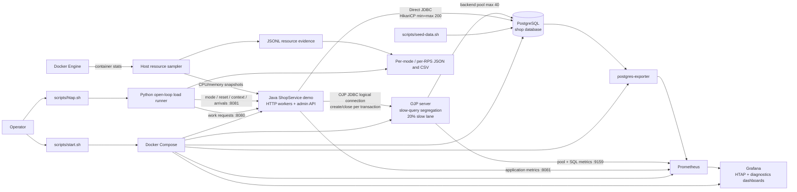

# OJP Live Demo

## What does this demonstrate?

Microservices often scale horizontally, and each instance may keep its own
database connection pool. Ten instances with 20 connections each can use 200
PostgreSQL connections:

```text
10 application instances × 20 connections = 200 PostgreSQL connections
```

Traditional client-side pools can consume many database connections. Open J Proxy
(OJP) centralizes pooling: applications create logical JDBC connections while
OJP reuses a 40-connection PostgreSQL backend pool.

```text
Direct JDBC: 10 × 20 client connections → PostgreSQL (200)
OJP:         10 instances → logical connections → OJP → PostgreSQL (40)
```

This demo uses one application process with a 200-connection HikariCP pool to
emulate the aggregate connection footprint of ten services. It is not ten
independent application instances and does not reproduce every aspect of
distributed scaling. The comparison deliberately uses 200 versus 40 connections;
it is not an equal-sized pool benchmark and does not assume OJP is faster.

The default workload is 98% transactional OLTP operations and 2% analytical
report queries. Slow analytical queries can interfere with transactional
traffic. OJP slow-query segregation reserves 20% of admission capacity for
classified slow queries to help protect the fast lane. The benchmark verifies
runtime configuration and reports whether slow SQL classification was actually
observed.

## Start the demo

```bash
bash scripts/start.sh
```

On first start, the script creates the schema and populates the database. Later
starts retain the existing data.

## Open Grafana

Open [http://localhost:3000/d/ojp-benchmark](http://localhost:3000/d/ojp-benchmark)
and log in with **admin / demo-local-only**. The main dashboard defaults to the
measurement phase; choose `warmup` from the phase selector to inspect warm-up.
The diagnostics dashboard contains separate PostgreSQL connection, transaction
rate, and tuple-rate graphs.

## Run the HTAP benchmark

```bash
bash scripts/htap.sh
```

This is equivalent to:

```bash
bash scripts/htap.sh \
  --rps 8,256,8,8 \
  --warmup 10 --duration 30 \
  --oltp-percent 98 --olap-percent 2
```

The default profile starts at 8 requests/second, jumps to 256, then returns to
8 twice. The sharp jump simulates a sudden traffic spike; the post-spike windows
show observed behavior as load returns to baseline. Each rate level is measured
independently: the benchmark drains work, resets the database baseline, and
warms up before its 30-second measurement. Thus, the ordered profile compares
the spike and low-load windows consistently; it is not one uninterrupted
stateful run. Every interval has a 10-second warm-up. Direct JDBC and OJP run
sequentially, never at the same time. The 98/2 mix keeps OLTP representative
while still exercising real analytical queries. OJP segregation is mandatory,
with a 20% slow lane. If no slow SQL classification is observed, the result
states that isolation was not demonstrated.

`htap.sh` is the only benchmark entrypoint: it always measures Direct JDBC
followed by OJP, with no scenario, single-path, or warmup-only modes. It rebuilds
the load image before each run so an older cached runner cannot reject the HTAP
scenario. The separate integration suite is for automated regression coverage.

Options include `--rps` with an ordered comma-separated
sequence, `--warmup`, `--duration`, `--request-timeout` for measured requests,
`--control-timeout` for mode switches and controls, `--max-in-flight`, `--seed`,
`--oltp-percent`/`--olap-percent`, and `--operation-mix`. Defaults are 98% OLTP
/ 2% OLAP; override them for a different workload mix. Use `--help` for the full
list. Results are written as JSON and CSV under `results/`.

## How the components fit together



Direct JDBC and OJP are exercised sequentially by the same runner. The app
exports labeled application metrics; Prometheus also scrapes OJP and PostgreSQL
exporter telemetry. The host-side resource sampler publishes PostgreSQL CPU and
memory snapshots and retains the raw evidence alongside benchmark results.

## Understand the results

- **Offered RPS** is the scheduled request rate; **successful throughput** counts
  completed transactions.
- **OLTP P95** is the 95th-percentile latency of transactional operations and is
  the primary performance metric. **OLAP P95** covers report queries.
- **Errors and drops** distinguish failed transactions from requests the bounded
  generator could not dispatch.
- **Physical database connections** count PostgreSQL sessions owned by the
  selected application mode. Logical JDBC opens/closes are shown separately.
- A lower OJP connection count with useful successful throughput indicates
  connection consolidation. Better OLTP latency while OLAP runs indicates
  transactional isolation. Rising latency, errors, drops, or saturated pools
  indicate overload; report those outcomes rather than assuming a winner.

The comparison table saves each mode/RPS measurement independently, including
PostgreSQL CPU and physical connections. Direct and OJP run sequentially, so
these measurements are not compared at a misleading shared wall-clock timestamp.
Short runs and warm caches are demonstrations, not publishable performance
claims.

## Stop or reset

Stop containers without deleting persistent database data:

```bash
bash scripts/stop.sh
```

To delete the demo's persistent data and regenerate it on the next start:

```bash
bash scripts/reset.sh --destroy-data
bash scripts/start.sh
```

## Run integration tests

```bash
bash scripts/test-integration.sh
```

The isolated integration suite checks real PostgreSQL and OJP transactions,
connection pooling and cleanup, sequential mode comparisons, workload ratios,
warm-up separation, slow-query telemetry, Grafana provisioning, and HA failover.
By default it exercises the full 200-connection Direct JDBC pool; `--small` is an
explicit lower-resource profile.

See [docs/TECHNICAL.md](docs/TECHNICAL.md) for architecture, configuration,
metrics, and validation details.
